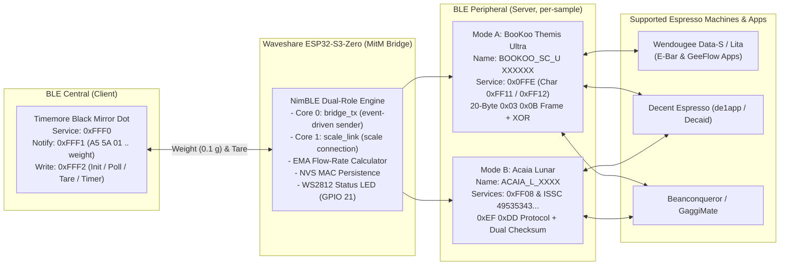

# Timemore Black Mirror Dot — Dual-Role BLE Bridge for Espresso Machines & Apps

[](https://www.espressif.com/)
[](https://github.com/espressif/arduino-esp32)
[](https://github.com/h2zero/NimBLE-Arduino)
[](LICENSE)

An ultra-low-latency Bluetooth Low Energy (BLE) Man-in-the-Middle (MitM) protocol translator built for the **Waveshare ESP32-S3-Zero** (and compatible ESP32-S3 boards).

The **Timemore Black Mirror Dot** uses a proprietary BLE protocol (service `0xFFF0`, frames `A5 5A ...`) that is not natively supported by commercial smart espresso machines (such as **Wendougee Data-S / Lita**) or popular profiling applications (**Wendougee E-Bar**, **GeeFlow**, **Decaid**). This firmware bridges that gap by simultaneously operating as a **BLE Central (Client)** connected to your Timemore Dot scale and a **BLE Peripheral (Server)** emulating either a **BooKoo Themis Ultra** or an **Acaia Lunar**, forwarding every weight sample the instant it arrives.

---

## Key Features

- **Simultaneous Dual-Role BLE Architecture (Central + Peripheral):**
  - **BLE Central (Input):** Automatically discovers, pairs with, and streams real-time weight data from the **Timemore Black Mirror Dot** (service `0xFFF0`). On connect it replays the official Timemore app's init sequence and then polls the scale every 10 seconds to prevent auto-off (same protocol as the native Dot support in de1app).
  - **BLE Peripheral (Output):** Emulates either a **BooKoo Themis Ultra** (`BOOKOO_SC_U XXXXXX`, default) or an **Acaia Lunar** (`ACAIA_L_XXXX`). Each sample from the scale (10 Hz) is forwarded immediately, with a 100 ms filler packet only if the scale goes quiet.
- **Low-Latency Multicore Pipeline (ESP32-S3 dual core):** see [Low-Latency Architecture](#low-latency-architecture). Measured internal latency (sample arrives at the ESP32 → notification handed to the BLE stack): **~0.33 ms average, < 0.7 ms worst case**.
- **Broad Ecosystem Compatibility:**
  - **Wendougee Espresso Machines (Data-S / Lita):** Full compatibility with the espresso machine's internal BLE controller and both the official **Wendougee E-Bar** app and the community **[GeeFlow](https://github.com/drobekk/GeeFlow)** app (populates Modbus Holding Registers `1415 WEIGHT` and `1423 WEIGHT_RATE` with real-time weight and EMA-smoothed flow rate).
- **Instant Reconnection After Scale Power-Cycle (Zero Manual Re-Pairing):**
  - Persists the scale's MAC address and BLE address type in non-volatile flash (**NVS**).
  - Handles the Timemore Dot's anonymous wake-up behavior (when powered on normally, the scale advertises with an empty name `""` and requires an active scan hit before `connect()` to avoid NimBLE error `574`).
- **Continuous Advertising (Zero Radio Starvation):**
  - Background scanning uses a lightweight 25% radio duty cycle (`Interval=60ms, Window=15ms`) and **never** stops BLE advertising while waiting for the scale to turn on, ensuring espresso machines and tablets can discover the bridge at any time.
- **Bidirectional Command Translation:**
  - Translates incoming **Tare** and **Timer (Start / Stop / Reset)** commands from the espresso machine or app into native Timemore Dot commands (written to `0xFFF2`, byte-exact copies of the frames used by de1app), coupled with an instant software tare (the app sees `0.0 g` on the very next packet).
  - Calculates the flow rate (g/s) once per real scale sample, using the sample's arrival timestamp and EMA filtering, and sends it in the emulated BooKoo data stream.
- **Visual RGB Status LED & Single-Button NVS Reset:**
  - Real-time connection feedback via the onboard **WS2812 RGB LED (`GPIO 21`)**.
  - Hold the onboard **`BOOT` button (`GPIO 0`)** for 3 seconds to clear the saved scale MAC from NVS and pair with a new Timemore scale.

---

## System Architecture



---

## Low-Latency Architecture

The firmware uses both cores of the ESP32-S3 explicitly (FreeRTOS SMP):

| Core | Task | Priority | Responsibility |
| :---: | :--- | :---: | :--- |
| 0 | BT controller + `nimble_host` | 23 / 21 | BLE stack (all NimBLE callbacks run here). |
| 0 | **`bridge_tx`** | 20 | **Single sender to the app/machine.** Woken by FreeRTOS notification bits the moment the scale callback returns, on the same core as the BLE host (no cross-core hop). Sends weight, handshake replies and timer. |
| 1 | **`scale_link`** | 3 | Everything that can block: scanning, synchronous `connect()` (up to 4 s), GATT discovery, Dot init sequence, polling, physical tare/timer writes. While it waits, `bridge_tx` keeps serving the app, so the handshake never stalls during a scale reconnect. |
| 1 | `loop()` | 1 | LED, BOOT button, Serial commands and statistics only. |

**Pipeline details**
- Events between tasks use FreeRTOS notification bits (atomic, no lost events).
- Every new sample is forwarded immediately; a minimum gap of 15 ms between weight packets (`WEIGHT_MIN_GAP_MS`) protects the ATT queue. A 100 ms filler packet is only sent if the scale is silent.
- Notifications are sent directly to the app's connection handle (no per-packet heap allocation).
- Link tuning after connect: scale link 15 ms interval (we are central), app link 15–30 ms requested (iOS/Android compliant) and re-requested up to 3 times if the central ignores it, plus 2M PHY on both links. Tuning is delayed (1.5 s scale / 3 s app) to avoid colliding with SMP encryption or the app's GATT discovery.

**Latency budget** (measured with an Android tablet running de1app as the central):

| Segment | Average | Worst case |
| :--- | :---: | :---: |
| Wait for scale connection event (15–20 ms interval) | ~8–10 ms | 15–20 ms |
| Processing inside the ESP32 | 0.33 ms | < 0.7 ms |
| Wait for app connection event (interval set by the central) | half the interval | 1 interval |

The scale itself samples at **10 Hz**, and the app-side connection interval is chosen by the central; at 60 ms (observed before the iOS/Android-compliant request was added) it dominated the bridge's latency.

**Tuning switches** (top of the `.ino`): `WEIGHT_MIN_GAP_MS`, `SCALE_CONN_ITVL_MIN/MAX`, `APP_CONN_ITVL_MIN/MAX`, `ENABLE_2M_PHY_SCALE`, `ENABLE_2M_PHY_APP`, `ENABLE_LATENCY_STATS`.

---

## Compatibility with Decent Espresso Apps

- **de1app:** has had **native Timemore Dot support** since July 2026 ([de1app PR #345](https://github.com/decentespresso/de1app/pull/345)). With an up-to-date de1app you can connect the Dot directly, without this bridge. This firmware's Dot commands are byte-exact copies of that implementation.
- **Decaid (new Decent app):** has no Timemore driver. Decent declined native support and asked the community for an external scale plugin instead ([decaid #737](https://github.com/decentespresso/decaid/issues/737)). Decaid recognizes any device whose name contains `bookoo`, so the bridge in BooKoo mode should work with it (not yet tested).

---

## Repository Structure

```text
timemore-dot-ble-bridge/
├── Bascula_Bridge_ESP32S3/
│   └── Bascula_Bridge_ESP32S3.ino   # Main ESP32-S3 Arduino firmware (self-contained)
├── docs/
│   ├── PROTOCOLS.md                 # Detailed English BLE protocol & reverse-engineering reference
│   └── DOCUMENTACION_ES.md          # Complete documentation and guide in Spanish
├── .gitignore                       # Git ignore rules for Arduino/ESP32 build artifacts
├── LICENSE                          # MIT License
└── README.md                        # Project overview and setup instructions (English)
```

---

## Hardware Requirements

- **Microcontroller:** [Waveshare ESP32-S3-Zero](https://www.waveshare.com/esp32-s3-zero.htm) (or any ESP32-S3 development board).
  - **Onboard WS2812 RGB LED:** Connected to `GPIO 21`.
  - **Onboard BOOT Button:** Connected to `GPIO 0` (active `LOW` with internal pull-up).
- **Input Scale:** **Timemore Black Mirror Dot** (service `0xFFF0`). Other Timemore variants exposing `0xFFE0` (UART) or `0x181D` (Weight Scale) are detected as a fallback.
- **Power Supply:** Any 5V USB-C power adapter or direct USB port on your espresso machine / tablet dock.

---

## Installation & Arduino IDE 2.x Setup

### 1. Prerequisites
1. Install **[Arduino IDE 2.x](https://www.arduino.cc/en/software)**.
2. In **File -> Preferences -> Additional Boards Manager URLs**, add:
   ```text
   https://espressif.github.io/arduino-esp32/package_esp32_index.json
   ```
3. Open **Tools -> Board -> Boards Manager**, search for **`esp32`**, and install **Espressif Systems esp32 v3.3.x** (tested on `v3.3.1` and `v3.3.12`).
4. Open **Tools -> Manage Libraries**, search for **`NimBLE-Arduino`** by *h2zero*, and install **v2.x** (tested on `v2.5.2`). The low-latency features (direct per-connection notify, 2M PHY, link verification, latency stats) require v2.x; `v1.4.x` compatibility macros remain but that path is no longer tested.

### 2. Required Board Configuration (`Tools` Menu)
To prevent Octal PSRAM/Flash bootloops (`RTC_SW_CPU_RST`) on the **Waveshare ESP32-S3-Zero** (`ESP32-S3FH4R2`, 4MB Quad SPI Flash, 2MB Quad PSRAM), configure the **Tools** menu exactly as follows:

| Parameter | Required Setting |
| :--- | :--- |
| **Board** | **`Waveshare ESP32-S3-Zero`** *(or **`ESP32S3 Dev Module`** — **NEVER** select the `Octal` variant)* |
| **USB CDC On Boot** | **`Enabled`** *(required: the sketch calls `Serial.setTxTimeoutMs()`, which only exists in that mode)* |
| **USB Mode** | **`Hardware CDC and JTAG`** |
| **Flash Mode** | **`QIO 80MHz`** *(or `DIO 80MHz`)* |
| **Flash Size** | **`4MB (32Mb)`** |
| **Partition Scheme** | **`Default 4MB with spiffs (1.2MB APP/1.5MB SPIFFS)`** |
| **PSRAM** | **`Disabled`** *(or `QSPI PSRAM`)* |
| **CPU Frequency** | **`240MHz (WiFi)`** |
| **Upload Speed** | **`921600`** |

### 3. Selecting the Emulation Mode (BooKoo vs. Acaia)
Open [`Bascula_Bridge_ESP32S3/Bascula_Bridge_ESP32S3.ino`](Bascula_Bridge_ESP32S3/Bascula_Bridge_ESP32S3.ino) and find `#define EMULATE_BOOKOO` (section *"MODO DE EMULACIÓN"* near the top of the file):
- **BooKoo Themis Ultra Mode (Default — Recommended for Wendougee, GeeFlow & de1app):**
  ```cpp
  #define EMULATE_BOOKOO
  ```
  Advertises as `BOOKOO_SC_U XXXXXX` with service `0x0FFE` (`0xFF11` / `0xFF12`).
- **Acaia Lunar Mode (For Acaia-only hosts):**
  Comment out the define:
  ```cpp
  // #define EMULATE_BOOKOO
  ```
  Advertises as `ACAIA_L_XXXX` with services `0xFF08`, `0x1820`, and Microchip ISSC (`49535343-fe7d-4ae5-8fa9-9fafd205e455`).

---

## Pairing & Usage Guide

### Step 1: First-Time Pairing with the Timemore Dot
1. Power on the **ESP32-S3-Zero** bridge. The LED will **blink Blue** while it searches for the scale.
2. Turn on your **Timemore Black Mirror Dot** and enable its Bluetooth pairing mode (if not already advertising).
3. Within 1–3 seconds, the bridge will detect the scale, connect to `0xFFF0`, subscribe to weight notifications (`0xFFF1`), send the Dot init sequence (~2.5 s) and store its MAC address in **NVS**.
4. The LED will turn **Solid Cyan**, indicating the scale is connected and waiting for an espresso machine or app.
5. **Subsequent Power-Ons:** You do **not** need to put the Timemore Dot into pairing mode ever again. Simply turn the scale on; the bridge detects its anonymous advertisement and connects automatically in ~1–2 seconds.

### Step 2: Connecting to Wendougee (Data-S / Lita via E-Bar or GeeFlow)
> **Important Architecture Note:** In the Wendougee ecosystem, the Android tablet does **not** connect directly to the Bluetooth scale, and the app's main *"Add Device"* scanner only looks for `Wendougee_XXXXXXXXXXXX` espresso machines. Instead, **the espresso machine's internal BLE board** scans for and connects to the scale.

1. Ensure `#define EMULATE_BOOKOO` is enabled in the firmware and no other phone/tablet app (like `de1app`) is currently connected to the bridge.
2. Open **Wendougee E-Bar** or **GeeFlow** on your tablet and connect to your **Wendougee espresso machine**.
3. Navigate to **Machine Settings -> Connectivity -> Smart Scale**.
4. Toggle **Smart Scale ON** and tap **Scan / Rescan**.
5. Select **`BOOKOO_SC_U XXXXXX`** from the discovered list.
6. The espresso machine will connect directly to the bridge. The bridge's LED will turn **Solid Green**, and real-time weight and flow rate will appear on the machine's brew screen.

### Step 3: Connecting to Decent Espresso (`de1app` / Decaid) or Beanconqueror
1. Open **de1app** (`Settings -> Machine -> Accessories -> Search`), **Decaid**, or **Beanconqueror** (`Scales -> Connect`).
2. Select **`BOOKOO_SC_U XXXXXX`** (BooKoo mode) or **`ACAIA_L_XXXX`** (Acaia mode).
3. The LED on the bridge will turn **Solid Green**.

> Recent de1app versions support the Timemore Dot natively; see [Compatibility with Decent Espresso Apps](#compatibility-with-decent-espresso-apps).

---

## Onboard RGB LED Status Codes (`GPIO 21`)

| LED State | Meaning |
| :--- | :--- |
| **Blinking Blue** `(450 ms)` | Neither the Timemore Dot nor the app/machine is connected; searching for the scale. |
| **Solid Cyan** | Timemore Dot is **connected**, waiting for the espresso machine / app. |
| **Solid Amber** | Espresso machine / app is **connected**, waiting for the Timemore Dot. |
| **Solid Green** | **Full bridge active** (Timemore Dot + espresso machine/app both connected). |
| **White Flash** `(180 ms)` | Tare executed (from the app, the `BOOT` button or the Serial console). |
| **Solid Magenta/Pink** | `BOOT` button being held (on the way to the 3-second NVS reset). |
| **Blinking Magenta** `(6x, 120 ms)` | Saved scale MAC erased from NVS; searching for any nearby Timemore by best RSSI. |

---

## Interactive USB Serial Console (`115200 baud`)

Connect the board to your computer via USB-C and open the Arduino Serial Monitor at `115200 baud`. Every 5 seconds, the bridge prints a health summary, the negotiated link parameters and the latency statistics for the last window:

```text
[  130028 ms] [STATUS] Dot=CONECTADA (a4:6d:33:91:a3:41) | AppAcaia=CONECTADA (BOOKOO_SC_U CE5710) | Peso=  -1.1g | Bat=90% | Rx=1039 Tx=675 | Heap=226964 B
[  130029 ms] [LINK] Dot: itvl=20.00ms lat=0 phy=2/2M | App: itvl=60.00ms lat=0 phy=2/2M mtu=256
[  130029 ms] [LAT] n=49 (9.8 Hz) pisadas=0 | dt balanza ms min/avg/max=100/102/200 | despertar us=34/42/100 | e2e us=291/337/626
[  130029 ms] [LAT] e2e hist <0.25ms:0 <1ms:49 <5ms:0 <15ms:0 >=15ms:0 | txPeso=50 txFallos=0
```

- **`[LINK]`**: connection interval, slave latency, PHY and MTU actually accepted by each peer.
- **`[LAT]`**: real scale sample rate (`dt balanza`), samples overwritten before processing (`pisadas`), task wake-up time, and **e2e** = sample arrival at the ESP32 → notification handed to the BLE stack (excludes air time), with a histogram and send failures. The instrumentation only stores µs timestamps and counters in RAM; it can be disabled with `ENABLE_LATENCY_STATS 0`.
- **`[TIMEMORE-RX]`**: on each scale connection, the first 3 raw weight frames and the decoded weight, to check against the Dot's display.

You can also send single-character commands followed by `Enter`:
- `?` or `i` : Print the status summary.
- `l` : Print link parameters and latency statistics now.
- `t` : Trigger an immediate **Tare** (software + physical).
- `r` : Erase the saved Timemore Dot MAC from NVS and restart scanning.
- `s` : Force a new BLE scan cycle.
- `p` : Pause / resume scanning for the scale (frees the radio for the app).

---

## Documentation & Credits

- **[English Protocol & Reverse-Engineering Reference (`docs/PROTOCOLS.md`)](docs/PROTOCOLS.md)**
- **[Documentación Completa en Español (`docs/DOCUMENTACION_ES.md`)](docs/DOCUMENTACION_ES.md)**
- Timemore Dot command frames and weight format taken from **[`decentespresso/de1app`](https://github.com/decentespresso/de1app)** (PR #345 by SongPaul, reverse-engineered from the official Timemore app).
- Special thanks to the open-source espresso community, including **[`drobekk/GeeFlow`](https://github.com/drobekk/GeeFlow)**, **[`BooKooCode/OpenSource`](https://github.com/BooKooCode/OpenSource)**, **[`gaggimate/esp-arduino-ble-scales`](https://github.com/gaggimate/esp-arduino-ble-scales)**, and **[` Graphefruit/Beanconqueror`](https://github.com/graphefruit/Beanconqueror)** for their protocol research.

