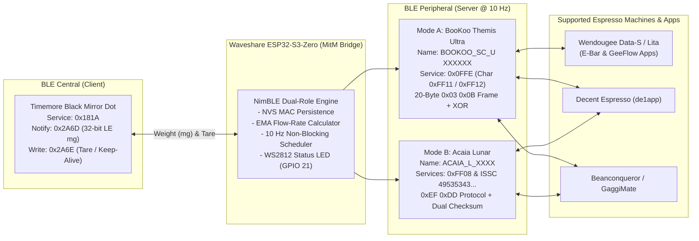

# Timemore Black Mirror Dot — Dual-Role BLE Bridge for Espresso Machines & Apps

[](https://www.espressif.com/)
[](https://github.com/espressif/arduino-esp32)
[](https://github.com/h2zero/NimBLE-Arduino)
[](LICENSE)

An ultra-low-latency Bluetooth Low Energy (BLE) Man-in-the-Middle (MitM) protocol translator built for the **Waveshare ESP32-S3-Zero** (and compatible ESP32-S3 boards).

The **Timemore Black Mirror Dot** uses a proprietary BLE service (`0x181A` -> `0x2A6D`/`0x2A6E`) that is not natively supported by commercial smart espresso machines (such as **Wendougee Data-S / Lita** or **Decent Espresso**) or popular profiling applications (**Wendougee E-Bar**, **GeeFlow**, ). This firmware bridges that gap by simultaneously operating as a **BLE Central (Client)** connected to your Timemore Dot scale and a **BLE Peripheral (Server)** emulating either a **BooKoo Themis Ultra** or an **Acaia Lunar** at **10 Hz**.

---

## Key Features

- **Simultaneous Dual-Role BLE Architecture (Central + Peripheral):**
  - **BLE Central (Input):** Automatically discovers, pairs with, and streams real-time weight data from the **Timemore Black Mirror Dot** (`0x181A`), while sending automatic Keep-Alive packets every 25 seconds to prevent auto-off during espresso extraction.
  - **BLE Peripheral (Output):** Emulates either a **BooKoo Themis Ultra** (`BOOKOO_SC_U XXXXXX`, default) or an **Acaia Lunar** (`ACAIA_L_XXXX`) at **10 Hz (`100 ms` intervals)** with zero queue congestion.
- **Broad Ecosystem Compatibility:**
  - **Wendougee Espresso Machines (Data-S / Lita):** Full compatibility with the espresso machine's internal BLE controller and both the official **Wendougee E-Bar** app and the community **[GeeFlow](https://github.com/drobekk/GeeFlow)** app (populates Modbus Holding Registers `1415 WEIGHT` and `1423 WEIGHT_RATE` with real-time weight and EMA-smoothed flow rate).
  - **Decent Espresso (`de1app`):** Works seamlessly in both BooKoo and Acaia modes for gravimetric stop-at-weight and real-time flow graphing.
  - **Beanconqueror / GaggiMate / Pressensor:** Full support for weight streaming, bidirectional Tare, and Stopwatch commands.
- **Instant Reconnection After Scale Power-Cycle (Zero Manual Re-Pairing):**
  - Persists the scale's MAC address and BLE address type in non-volatile flash (**NVS**).
  - Handles the Timemore Dot's anonymous wake-up behavior (when powered on normally, the scale advertises with an empty name `""` and requires an active scan hit before `connect()` to avoid NimBLE error `574`).
- **Continuous Advertising (Zero Radio Starvation):**
  - Background scanning uses a lightweight 25% radio duty cycle (`Interval=60ms, Window=15ms`) and **never** stops BLE advertising while waiting for the scale to turn on, ensuring espresso machines and tablets can discover the bridge at any time.
- **Bidirectional Command Translation:**
  - Translates incoming **Tare** and **Timer (Start / Stop / Reset)** commands from the espresso machine or app into native Timemore Dot commands (`0x2A6E`), coupled with an instant software tare fallback.
- **Visual RGB Status LED & Single-Button NVS Reset:**
  - Real-time connection feedback via the onboard **WS2812 RGB LED (`GPIO 21`)**.
  - Hold the onboard **`BOOT` button (`GPIO 0`)** for 3 seconds to clear the saved scale MAC from NVS and pair with a new Timemore scale.

---

## System Architecture



---

## Repository Structure

```text
timemore-dot-ble-bridge/
├── Bascula_Bridge_ESP32S3/
│   └── Bascula_Bridge_ESP32S3.ino   # Main ESP32-S3 Arduino firmware (self-contained)
├── docs/
│   ├── PROTOCOLS.md                 # Detailed English BLE protocol & reverse-engineering reference
│   └── DOCUMENTACION_ES.md          # Complete documentation and guide in Spanish
├── .gitignore                       # Git ignore rules for Arduino/ESP32 build artifacts
├── LICENSE                          # MIT License
└── README.md                        # Project overview and setup instructions (English)
```

---

## Hardware Requirements

- **Microcontroller:** [Waveshare ESP32-S3-Zero](https://www.waveshare.com/esp32-s3-zero.htm) (or any ESP32-S3 development board).
  - **Onboard WS2812 RGB LED:** Connected to `GPIO 21`.
  - **Onboard BOOT Button:** Connected to `GPIO 0` (active `LOW` with internal pull-up).
- **Input Scale:** **Timemore Black Mirror Dot** (or BLE-enabled Timemore Black Mirror Basic/Nano using service `0x181A`).
- **Power Supply:** Any 5V USB-C power adapter or direct USB port on your espresso machine / tablet dock.

---

## Installation & Arduino IDE 2.x Setup

### 1. Prerequisites
1. Install **[Arduino IDE 2.x](https://www.arduino.cc/en/software)**.
2. In **File -> Preferences -> Additional Boards Manager URLs**, add:
   ```text
   https://espressif.github.io/arduino-esp32/package_esp32_index.json
   ```
3. Open **Tools -> Board -> Boards Manager**, search for **`esp32`**, and install **Espressif Systems esp32 v3.3.x** (tested on `v3.3.1`).
4. Open **Tools -> Manage Libraries**, search for **`NimBLE-Arduino`** by *h2zero*, and install **v2.x** (the firmware includes automatic compile-time compatibility macros for both `NimBLE-Arduino v2.x` and `v1.4.x`).

### 2. Required Board Configuration (`Tools` Menu)
To prevent Octal PSRAM/Flash bootloops (`RTC_SW_CPU_RST`) on the **Waveshare ESP32-S3-Zero** (`ESP32-S3FH4R2`, 4MB Quad SPI Flash, 2MB Quad PSRAM), configure the **Tools** menu exactly as follows:

| Parameter | Required Setting |
| :--- | :--- |
| **Board** | **`Waveshare ESP32-S3-Zero`** *(or **`ESP32S3 Dev Module`** — **NEVER** select the `Octal` variant)* |
| **USB CDC On Boot** | **`Enabled`** |
| **USB Mode** | **`Hardware CDC and JTAG`** |
| **Flash Mode** | **`QIO 80MHz`** *(or `DIO 80MHz`)* |
| **Flash Size** | **`4MB (32Mb)`** |
| **Partition Scheme** | **`Default 4MB with spiffs (1.2MB APP/1.5MB SPIFFS)`** |
| **PSRAM** | **`Disabled`** *(or `QSPI PSRAM`)* |
| **CPU Frequency** | **`240MHz (WiFi)`** |
| **Upload Speed** | **`921600`** |

### 3. Selecting the Emulation Mode (BooKoo vs. Acaia)
Open [`Bascula_Bridge_ESP32S3/Bascula_Bridge_ESP32S3.ino`](Bascula_Bridge_ESP32S3/Bascula_Bridge_ESP32S3.ino) and check line 63:
- **BooKoo Themis Ultra Mode (Default — Recommended for Wendougee, GeeFlow & de1app):**
  ```cpp
  #define EMULATE_BOOKOO
  ```
  Advertises as `BOOKOO_SC_U XXXXXX` with service `0x0FFE` (`0xFF11` / `0xFF12`).
- **Acaia Lunar Mode (For Acaia-only hosts):**
  Comment out line 63:
  ```cpp
  // #define EMULATE_BOOKOO
  ```
  Advertises as `ACAIA_L_XXXX` with services `0xFF08`, `0x1820`, and Microchip ISSC (`49535343-fe7d-4ae5-8fa9-9fafd205e455`).

---

## Pairing & Usage Guide

### Step 1: First-Time Pairing with the Timemore Dot
1. Power on the **ESP32-S3-Zero** bridge. The LED will blink **Red** (no saved MAC) or **Yellow** (scanning).
2. Turn on your **Timemore Black Mirror Dot** and enable its Bluetooth pairing mode (if not already advertising).
3. Within 1–3 seconds, the bridge will detect the scale, connect to `0x181A`, subscribe to weight notifications (`0x2A6D`), and store its MAC address in **NVS**.
4. The LED will turn **Solid Blue**, indicating the scale is connected and waiting for an espresso machine or app.
5. **Subsequent Power-Ons:** You do **not** need to put the Timemore Dot into pairing mode ever again. Simply turn the scale on; the bridge detects its anonymous advertisement and connects automatically in ~1–2 seconds.

### Step 2: Connecting to Wendougee (Data-S / Lita via E-Bar or GeeFlow)
> **Important Architecture Note:** In the Wendougee ecosystem, the Android tablet does **not** connect directly to the Bluetooth scale, and the app's main *"Add Device"* scanner only looks for `Wendougee_XXXXXXXXXXXX` espresso machines. Instead, **the espresso machine's internal BLE board** scans for and connects to the scale.

1. Ensure `#define EMULATE_BOOKOO` is enabled in the firmware and no other phone/tablet app (like `de1app`) is currently connected to the bridge.
2. Open **Wendougee E-Bar** or **GeeFlow** on your tablet and connect to your **Wendougee espresso machine**.
3. Navigate to **Machine Settings -> Connectivity -> Smart Scale**.
4. Toggle **Smart Scale ON** and tap **Scan / Rescan**.
5. Select **`BOOKOO_SC_U XXXXXX`** from the discovered list.
6. The espresso machine will connect directly to the bridge. The bridge's LED will turn **Solid Green**, and real-time weight and flow rate will appear on the machine's brew screen.

### Step 3: Connecting to Decent Espresso (`de1app`) or Beanconqueror
1. Open **de1app** (`Settings -> Machine -> Accessories -> Search`) or **Beanconqueror** (`Scales -> Connect`).
2. Select **`BOOKOO_SC_U XXXXXX`** (BooKoo mode) or **`ACAIA_L_XXXX`** (Acaia mode).
3. The LED on the bridge will turn **Solid Green**.

---

## Onboard RGB LED Status Codes (`GPIO 21`)

| LED State | Meaning |
| :--- | :--- |
| **Blinking Red** `(250ms ON / 250ms OFF)` | Both the Timemore Dot and Host App/Machine are disconnected. |
| **Blinking Yellow** `(300ms ON / 300ms OFF)` | Actively scanning for or connecting to the Timemore Dot. |
| **Solid Blue** | Timemore Dot is **Connected**, waiting for Espresso Machine / App to connect. |
| **Solid Purple** | Espresso Machine / App is **Connected**, waiting for Timemore Dot to turn on. |
| **Solid Green** | **Full Bridge Active** (Timemore Dot + Espresso Machine/App both connected). |
| **Fast Cyan Flash** `(5x)` | NVS memory cleared via 3-second hold on the `BOOT` button (`GPIO 0`). |

---

## Interactive USB Serial Console (`115200 baud`)

Connect the board to your computer via USB-C and open the Arduino Serial Monitor at `115200 baud`. Every 5 seconds, the bridge prints a health summary:

```text
[   15024 ms] [STATUS] Dot=CONECTADA (a4:6d:33:91:a3:41) | AppAcaia=CONECTADA (BOOKOO_SC_U 895710) | Peso= +18.4g | Bat=90% | Rx=142 Tx=198 | Heap=242536 B
```

You can also send single-character commands followed by `Enter`:
- `?` or `i` : Print full diagnostic status (MAC addresses, connection flags, live weight, free heap).
- `t` : Trigger an immediate **Tare** command on the scale.
- `r` : Erase the saved Timemore Dot MAC from NVS and restart scanning.
- `s` : Force a new BLE scan cycle.

---

## Documentation & Credits

- **[English Protocol & Reverse-Engineering Reference (`docs/PROTOCOLS.md`)](docs/PROTOCOLS.md)**
- **[Documentación Completa en Español (`docs/DOCUMENTACION_ES.md`)](docs/DOCUMENTACION_ES.md)**
- Special thanks to the open-source espresso community, including **[`drobekk/GeeFlow`](https://github.com/drobekk/GeeFlow)**, **[`BooKooCode/OpenSource`](https://github.com/BooKooCode/OpenSource)**, **[`gaggimate/esp-arduino-ble-scales`](https://github.com/gaggimate/esp-arduino-ble-scales)**, and **[` Graphefruit/Beanconqueror`](https://github.com/graphefruit/Beanconqueror)** for their protocol research.

