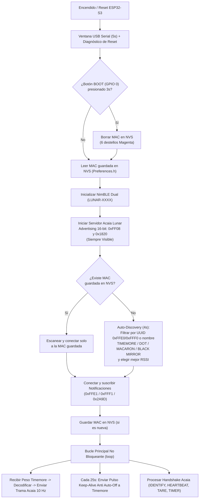
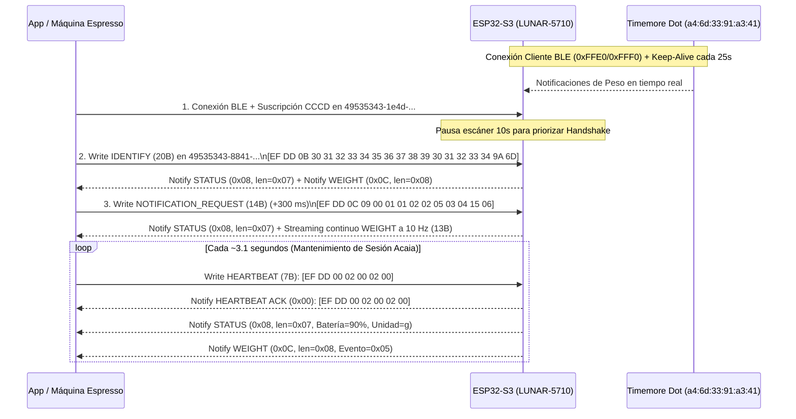

# Documentación Técnica: Puente BLE Timemore Dot a Emulador Acaia Lunar (ESP32-S3-Zero)

## 1. Descripción General
Este firmware convierte una placa **Waveshare ESP32-S3-Zero** en un puente Bluetooth Low Energy (BLE) transparente (**Man-in-the-Middle / MitM**) que opera simultáneamente en modo **Cliente BLE** y **Servidor BLE** utilizando la pila `NimBLE-Arduino`:

1. **Entrada (Rol Cliente BLE):** Se conecta automáticamente a una balanza **Timemore Black Mirror Dot** (compatible también con Timemore Basic / Plus / Nano), recibe las notificaciones de peso en tiempo real, mantiene activa la báscula para evitar su apagado automático y permite enviarle comandos de **Tara** y **Cronómetro**.
2. **Salida (Rol Servidor BLE):** Emula de forma estricta una balanza **Acaia Lunar** (`LUNAR-XXXX`), exponiendo los servicios primarios `0xFF08` y `0x1820` para ser detectada nativamente por máquinas y aplicaciones de espresso como **Wendougee, Profitec Move 2.0, Decent Espresso, Smart Espresso Profiler y Beanconqueror**.

---

## 2. Códigos de Colores del LED RGB Integrado (WS2812 - `GPIO 21`)

El LED RGB WS2812 integrado en la placa **Waveshare ESP32-S3-Zero** (`GPIO 21`) indica en todo momento el estado operativo del puente BLE:

| Color / Patrón del LED | Valores RGB (Base) | Estado del Sistema | Descripción Detallada |
| :--- | :---: | :--- | :--- |
| 🔵 **Azul Parpadeante** *(cada 450 ms)* | `(0, 70, 255)` | **Buscando Balanza** | Ni la Timemore Dot ni la App están conectadas. El ESP32-S3 está escaneando activamente en busca de la Timemore Dot. |
| 🩵 **Cian Fijo** | `(0, 180, 255)` | **Conectado a Timemore Dot** | La balanza física Timemore Dot ya está enlazada y enviando peso. Esperando a que la App móvil o máquina de espresso se conecte al servidor `LUNAR-XXXX`. |
| 🟠 **Ámbar / Naranja Fijo** | `(255, 140, 0)` | **Conectado solo a la App** | La App de espresso está conectada al emulador Acaia Lunar, pero la balanza física Timemore Dot está apagada o fuera de rango (el ESP32 sigue buscándola en segundo plano). |
| 🟢 **Verde Fijo** | `(0, 255, 40)` | **Puente Activo (100% Operativo)** | Tanto la **Timemore Dot** como la **App móvil** están conectadas. El peso se traduce y transmite en tiempo real a 10 Hz. |
| ⚪ **Destello Blanco** *(180 ms)* | `(255, 255, 255)` | **Comando de TARA** | Destello breve que confirma que se acaba de ejecutar una orden de **Tara** (solicitada desde la App, botón `BOOT` o Monitor Serie). |
| 🩷 **Rosa / Magenta Fijo** | `(255, 0, 128)` | **Botón BOOT Presionado** | Indica que el usuario está manteniendo presionado el botón `BOOT` (`GPIO 0`) rumbo a los 3 segundos para resetear la memoria. |
| 🟣 **Magenta Parpadeante Rápido** *(6 destellos)* | `(255, 0, 180)` | **Reset de Emparejamiento (NVS)** | Confirma que la dirección MAC guardada en memoria Flash NVS fue borrada y el dispositivo vuelve al modo de búsqueda abierta por mejor señal (RSSI). |

> **Nota técnica sobre el driver LED:** El firmware implementa un sistema de caché RGB (`writeRgbPixelSafe()`) que solo invoca al periférico `RMT` (`rgbLedWrite`) cuando el color realmente cambia, evitando interferencias de hardware o sobrecarga de interrupciones con el radio BLE a 2.4 GHz.

---

## 3. Funciones del Botón Físico `BOOT` (`GPIO 0`)

El botón integrado `BOOT` (`GPIO 0`) cumple dos funciones sin necesidad de interfaces web ni menús externos:

1. **Pulsación Corta (`50 ms` a `1.2 s`):**
   - Ejecuta inmediatamente un comando de **TARA (Puesta a cero)** tanto hacia la balanza Timemore Dot como en el acumulador lógico de respaldo, produciendo un destello blanco en el LED RGB.
2. **Pulsación Larga (`>= 3 segundos`, al encender o en cualquier momento):**
   - Borra la dirección MAC almacenada en la partición NVS (`Preferences.h`).
   - Desconecta la balanza actual (si estaba conectada).
   - Parpadea 6 veces en color **Magenta**.
   - Reinicia el escáner BLE en modo **Auto-Discovery**, conectándose automáticamente a la balanza Timemore encendida con mejor señal (RSSI).

---

## 4. Lógica Interna y Arquitectura del Programa

### Diagrama de Flujo del Sistema



---

### 4.1. Lógica del Rol Cliente BLE y Anatomía del Protocolo Timemore Dot

#### A. Descubrimiento, Emparejamiento y Reconexión Instantánea (`isTimemoreAdvertisedDevice`, `evaluateScannedDevice` y `connectToTimemoreScale`)

1. **Diagnóstico del Error `err=574 (0x23E / 0x3E = BLE_ERR_CONN_ESTABLISHMENT)` y White List del SoC Phyplus (`A4:6D:33`):**
   - El prefijo MAC `a4:6d:33` corresponde al SoC BLE **Phyplus Technology (`PHY6222` / `PHY6252`)** integrado en la Timemore Dot.
   - Su pila BLE (`GAPBondMgr` con `GAPBOND_AUTO_SYNC_WL`) opera en dos estados de anuncio (`Adv_Filter_Policy`):
     - **Modo Emparejamiento Manual (`Adv_Filter_Policy = 0x00`):** Responde a solicitudes `SCAN_REQ` (enviando su nombre `"TIMEMORE..."` en `SCAN_RSP`) y acepta `CONNECT_IND` de cualquier dispositivo central.
     - **Encendido Normal / Reconexión (`Adv_Filter_Policy = 0x03 - White List Only`):** Emite paquetes `ADV_IND` (`advType=0, conn=1`) cada `1000 ms`, pero su capa de enlace ignora tanto `SCAN_REQ` (por eso aparece `Nombre='(Sin Nombre)'`) como `CONNECT_IND` (devolviendo **`err=574 / 0x3E`** tras 6 eventos de conexión) de cualquier dispositivo que **no haya completado un enlace SMP Bonding (`Just-Works`)** durante el modo emparejamiento.
   - **Soluciones implementadas en el firmware:**
     1. **Establecimiento Limpio de Enlace (`exchangeMTU = false`, 1M PHY y Pausa de 60 ms):**
        - Al detectar la balanza en `onResult()` (con `setScanResponseTimeout(150)` para no cortar el intercambio `SCAN_REQ -> SCAN_RSP` en el aire), el ESP32-S3 detiene el escáner y el advertising local, espera **60 ms** para estabilizar el estado del radio, fuerza **1M PHY** (`BLE_GAP_LE_PHY_1M_MASK`), usa parámetros estándar (`24..40`, `30–50 ms`) e invoca `pScaleClient->connect(targetAddr, true, false, false)` (`exchangeMTU = false`) para no inyectar paquetes `ATT_EXCHANGE_MTU_REQ` durante los primeros 6 eventos críticos de establecimiento del enlace.
     2. **Bonding BLE Asíncrono Post-GATT (`NimBLEDevice::setSecurityAuth(true, false, false)`):**
        - Configura `Just-Works Legacy Bonding` con distribución de claves `ENC | ID` (`BLE_SM_PAIR_KEY_DIST_ENC | BLE_SM_PAIR_KEY_DIST_ID`).
        - **Después** de completar `discoverAndSubscribeTimemore()` (para no colisionar con el semáforo interno `m_pTaskData` de `NimBLEClient`), ejecuta `pScaleClient->secureConnection(true)`. De este modo, al emparejar la Timemore Dot **una vez** en modo emparejamiento con este firmware, el SoC Phyplus registra la MAC del ESP32-S3 en su **White List** interna.
     3. **Trazas `[SCAN-RAW]` en Monitor Serie:** Imprime en hexadecimal la carga útil cruda de cada paquete de anuncio de la balanza y el estado del enlace SMP (`encrypted`, `bonded`).

---

#### B. Servicios y Características GATT de la Timemore Dot

Dependiendo de la revisión de hardware/firmware de la familia **Timemore Black Mirror (Dot / Basic Pro / Nano / Macaron)**, la balanza expone uno de los siguientes tres perfiles GATT (todos detectados y suscritos automáticamente por `discoverAndSubscribeTimemore()`):

| Perfil / Variante | UUID de Servicio | Característica **NOTIFY** (Balanza → ESP32-S3) | Característica **WRITE** (ESP32-S3 → Balanza) |
| :--- | :--- | :--- | :--- |
| **1. Timemore Open Scale (Principal en Dot / Basic Pro)** | `0xFFF0` | **`0xFFF1`** (`Notify` / `Read`) | **`0xFFF2`** (`Write` / `Write No Response`) |
| **2. Timemore UART Transparente (Telink / Tuya BLE)** | `0xFFE0` | **`0xFFE1`** (`Notify` / `Read`) | **`0xFFE2`** o **`0xFFE1`** (`Write`) |
| **3. Bluetooth SIG Weight Scale (Estándar)** | `0x181D` | **`0x2A9D`** (`Notify` / `Indicate`) | Escaneo automático en el servicio |

---

#### C. Anatomía de la Trama Binaria Timemore Open Scale (`0xA5, 0x5A`) y CRC-16/IBM

El protocolo nativo de la **Timemore Dot** sobre el servicio `0xFFF0` (`0xFFF1` / `0xFFF2`) utiliza tramas binarias encabezadas por los bytes mágicos **`0xA5, 0x5A`** y protegidas al final por un **CRC-16/IBM (MODBUS/ARC)** de 2 bytes:

```text
+--------+--------+--------+--------+--------+--------+--------------------+---------+---------+
| Byte 0 | Byte 1 | Byte 2 | Byte 3 | Byte 4 | Byte 5 | Bytes 6 .. (6+N-1) |  End-1  |   End   |
+--------+--------+--------+--------+--------+--------+--------------------+---------+---------+
|  0xA5  |  0x5A  | Opcode |  Cmd   | Len_H  | Len_L  |   Payload (N B)    | CRC16_H | CRC16_L |
+--------+--------+--------+--------+--------+--------+--------------------+---------+---------+
```

1. **Cabecera Mágica (`Bytes 0 y 1`):** Siempre fija en `0xA5, 0x5A`.
2. **Código de Operación (`Byte 2 - Opcode`):**
   - `0x01`: Notificación asíncrona o respuesta desde la balanza hacia el cliente (`Balanza → ESP32-S3`).
   - `0x02`: Consulta de lectura (`Read Request`) desde el cliente hacia la balanza (`ESP32-S3 → Balanza`).
   - `0x03`: Comando de acción/escritura (`Action Command`, como Tara o Timer) desde el cliente (`ESP32-S3 → Balanza`).
3. **Comando / Tópico (`Byte 3 - Cmd`):**
   - `0x01`: **Peso en tiempo real** y estabilidad.
   - `0x02`: **Estado del Cronómetro (Timer)**.
   - `0x05`: **Nivel de Batería** (`0–100%`).
   - `0x09`: **Iniciar Cronómetro (`Timer Start`)**.
   - `0x0A`: **Pausar/Detener Cronómetro (`Timer Stop`)**.
   - `0x0B`: **Reiniciar Cronómetro (`Timer Reset`)**.
   - `0x0D` (o `0x01` con `Opcode 0x03`): **Ejecutar Tara (`Tare` / Puesta a cero)**.
4. **Longitud del Payload (`Bytes 4 y 5 - Len_H, Len_L`):**
   - Entero de 16 bits sin signo en **Big-Endian** (`N = (Byte[4] << 8) | Byte[5]`) que indica cuántos bytes de datos vienen antes del CRC-16.
5. **Cálculo del Checksum `CRC-16/IBM` (`Bytes End-1 y End`):**
   - Se calcula sobre todos los bytes desde `Byte 0 (0xA5)` hasta el último byte del `Payload` (`6 + N` bytes) usando el polinomio reflejado **`0xA001`** (polinomio normal `0x8005`) y valor inicial **`0xFFFF`**:
     ```cpp
     uint16_t crc = 0xFFFF;
     for (size_t i = 0; i < length; i++) {
       crc ^= data[i];
       for (uint8_t bit = 0; bit < 8; bit++) {
         crc = (crc & 0x0001) ? ((crc >> 1) ^ 0xA001) : (crc >> 1);
       }
     }
     // CRC16_H = (crc >> 8) & 0xFF;  CRC16_L = crc & 0xFF;
     ```

---

#### D. Detalle Byte por Byte de las Tramas de la Timemore Dot

1. **Notificación de Peso en Formato Open Scale (`0xA5, 0x5A`, `Cmd = 0x01`):**
   - **Variante de 32 bits (`Len >= 5` bytes de payload):**
     ```text
     [0]  [1]  [2]  [3]  [4]  [5]  [6]   [7]  [8]  [9]  [10]    [11]    [12]
     0xA5 0x5A 0x01 0x01 0x00 0x05 Stable W3   W2   W1   W0    CRC16_H CRC16_L
     ```
     - `Byte 6 (Stable)`: `0x01` = lectura estable; `0x00` = lectura en movimiento.
     - `Bytes 7..10 (W3..W0)`: Entero de 32 bits con signo (`int32_t`) en **Big-Endian** expresado en décimas de gramo (`0.1 g`).
     - Conversión: $\text{Peso (g)} = \frac{\text{int32\_be}(W_3, W_2, W_1, W_0)}{10.0}$.
   - **Variante compacta de 16 bits (`Len == 2..4` bytes de payload):**
     ```text
     [0]  [1]  [2]  [3]  [4]  [5]  [6]  [7]  [8]     [9]     [10]
     0xA5 0x5A 0x01 0x01 0x00 0x03  W1   W0  Stable CRC16_H CRC16_L
     ```
     - `Bytes 6..7 (W1, W0)`: Entero de 16 bits con signo (`int16_t`) en **Big-Endian** en décimas de gramo (`0.1 g`).

2. **Notificación de Peso en Formato UART Transparente (`0xAA` o `0x55` en `0xFFE1`):**
   Algunas unidades Timemore transmiten tramas compactas de 6 a 14 bytes con cabecera `0xAA` o `0x55`:
   ```text
   [0]    [1]      [2]      [3]      [4]      [5]
   0xAA  Status  Weight_H Weight_L Battery  Checksum
   ```
   - `Byte 0`: Cabecera `0xAA` (o `0x55`).
   - `Byte 1 (Status)`:
     - `Bit 0 (0x01)`: `1` = Estable, `0` = Inestable.
     - `Bit 1 (0x02)` o `Bit 7 (0x80)` (o valor `0x2D` = `'-'`): Signo negativo (`-`).
   - `Bytes 2..3 (Weight_H, Weight_L)`: Magnitud de 16 bits sin signo en **Big-Endian** (`(Byte[2] << 8) | Byte[3]`) en décimas de gramo (`0.1 g`).
   - `Byte 4 (Battery)`: Porcentaje de batería (`1–100%`) si está presente.

3. **Comandos Enviados por el ESP32-S3 a la Timemore Dot (Tara, Timer y Keep-Alive):**

   | Acción | Trama Hexadecimal (`0xFFF2` Open Scale) | Trama Alternativa (`0xFFE1/0xFFE2` UART) |
   | :--- | :--- | :--- |
   | **Tara (Puesta a cero)** | `A5 5A 03 0D 00 00 [CRC_H] [CRC_L]` y `A5 5A 03 01 00 00 [CRC_H] [CRC_L]` | `AA 02 43 00 45` y `0x00` (1 byte) |
   | **Timer Start (Iniciar)** | `A5 5A 03 09 00 00 [CRC_H] [CRC_L]` | `AA 02 33 01 36` |
   | **Timer Stop (Pausar)** | `A5 5A 03 0A 00 00 [CRC_H] [CRC_L]` | `AA 02 33 00 35` |
   | **Timer Reset (Reiniciar)** | `A5 5A 03 0B 00 00 [CRC_H] [CRC_L]` | `AA 02 33 02 37` |
   | **Keep-Alive Batería (cada 25s)** | `A5 5A 02 05 00 00 [CRC_H] [CRC_L]` | Lectura GATT en `pScaleNotifyChar->readValue()` |
   | **Keep-Alive Timer (cada 25s)** | `A5 5A 02 02 00 00 [CRC_H] [CRC_L]` | — |

   > [!TIP]
   > **Tara Híbrida Instantánea:** Cuando la App o el usuario solicita una Tara (`executeTimemoreTare()`), el ESP32-S3 aplica en el mismo milisegundo un `softwareTareOffset = lastRawScaleWeightGrams` (poniendo el peso reportado a `0.0 g` de forma instantánea para la máquina de espresso) y simultáneamente transmite la trama física de Tara a la Timemore Dot. Cuando la balanza física confirma su puesta a cero (`|peso_crudo| < 0.8 g`), el offset por software se limpia automáticamente a `0.0f`.

---

### 4.2. Lógica del Rol Servidor BLE y Protocolo Acaia Lunar (2021 / Pyxis)

#### A. Publicidad BLE (`Advertising`) y Servicios GATT
1. **Paquete de Advertising Primario y Scan Response (`setupAcaiaServer`):**
   - **Nombre BLE:** `LUNAR-XXXX` (donde `XXXX` son los últimos 2 bytes en hexadecimal de la MAC de fábrica del ESP32-S3, por ejemplo `LUNAR-5710`).
   - **Paquete Primario (19 bytes `<= 31 bytes`):** Incluye Flags BLE, el UUID público de 16 bits **`0xFF08`** (`AD Type 0x03`) requerido por filtros de escaneo de Wendougee/Profitec y el nombre completo `LUNAR-XXXX`.
   - **Scan Response (18 bytes `<= 31 bytes`):** Incluye el UUID de 128 bits **`49535343-fe7d-4ae5-8fa9-9fafd205e455`** (Microchip/ISSC Transparent UART) propio de la **Acaia Lunar 2021**.
   - **Sin condición de bloqueo:** El servidor Acaia nunca detiene su anuncio ni desconecta a la App aunque la Timemore Dot esté apagada o se reinicie.

2. **Perfiles GATT Expuestos Simultáneamente:**
   - **Servicio Acaia Lunar 2021 / Pyxis (`49535343-fe7d-4ae5-8fa9-9fafd205e455` - ISSC Transparent UART):**
     - `49535343-8841-43f4-a8d4-ecbe34729bb3` (`Write` / `Write No Response`): Canal **RX** donde la App escribe los comandos (`IDENTIFY`, `NOTIFICATION_REQUEST`, `HEARTBEAT`, `TARE`, `TIMER`).
     - `49535343-1e4d-4bd9-ba61-23c647249616` (`Notify` / `Read`): Canal **TX** donde la balanza notifica peso a 10 Hz, estado de batería y ACKs.
   - **Servicio Primario `0xFF08` (Especificación / Wendougee):**
     - `0xFF10` (`Write` / `Write No Response`): Canal RX de comandos.
     - `0xFF11` (`Notify` / `Read`): Canal TX de notificaciones de peso.
   - *(Nota de diseño crítica: No se expone el servicio pre-2021 `0x1820 / 0x2A80` para evitar que librerías como `AcaiaArduinoBLE` entren en el modo legacy `OLD` de 10 bytes e ignoren las tramas modernas de 13 bytes de la Lunar 2021).*

---

#### B. Anatomía del Protocolo Acaia (`0xEF, 0xDD`), Regla de Longitud `N + 1` y Checksum Dual

Toda trama del protocolo Acaia Lunar —tanto las enviadas por la App como las respondidas por la balanza— comparte el siguiente formato binario:

```text
+--------+--------+---------+--------------------+--------+--------+
| Byte 0 | Byte 1 | Byte 2  | Bytes 3 .. (3+M-1) |  End-1 |   End  |
+--------+--------+---------+--------------------+--------+--------+
|  0xEF  |  0xDD  | msgType |   Payload (M B)    | cksum1 | cksum2 |
+--------+--------+---------+--------------------+--------+--------+
```

1. **Cabecera Mágica (`Bytes 0 y 1`):** Siempre fija en `0xEF, 0xDD`.
2. **Tipo de Mensaje (`Byte 2 - msgType`):**
   - `0x00` (`ACAIA_MSG_SYSTEM`): Latido de conexión (`Heartbeat`).
   - `0x04` (`ACAIA_MSG_TARE`): Orden de puesta a cero (`Tare`).
   - `0x07` (`ACAIA_MSG_INFO`): Información de versión de firmware (`v2.0.08` / `"LUNA"`).
   - `0x08` (`ACAIA_MSG_STATUS`): Estado de la balanza (batería, unidades en gramos, sonido, auto-off).
   - `0x0B` (`ACAIA_MSG_IDENTIFY`): Handshake de autenticación inicial de la App.
   - `0x0C` (`ACAIA_MSG_EVENT`): Solicitud de notificaciones (App → Balanza) o flujo de eventos de Peso/Timer/ACK (Balanza → App).
   - `0x0D` (`ACAIA_MSG_TIMER`): Control del cronómetro (`0 = Start`, `1 = Stop`, `2 = Reset`).
3. **Regla Crítica del Byte de Longitud (`Byte 3 = N_datos + 1`):**
   - En los mensajes estructurados con longitud (`0x08`, `0x07`, `0x0C`), el primer byte del payload (`Byte 3` del paquete) indica la longitud del bloque **contándose a sí mismo** (`Longitud = N_datos + 1 = sizeof(payload)`).
   - *Ejemplo real de la App (`NOTIFICATION_REQUEST`, 14 bytes):*
     `EF DD 0C [09] 00 01 01 02 02 05 03 04 [15 06]`
     Contiene **8 bytes de configuración** (`00 01 01 02 02 05 03 04`), por lo que el `Byte 3` vale **`0x09` (`8 + 1 = 9`)**.
   - *Ejemplo de nuestro paquete de Peso (`EVENT_WEIGHT`, 13 bytes):*
     `EF DD 0C [08] 05 W0 W1 W2 W3 Unit Flags [cksum1 cksum2]`
     Contiene **7 bytes de evento** (`05` + 4 bytes de peso + `Unit` + `Flags`), por lo que el `Byte 3` debe valer exactamente **`0x08` (`7 + 1 = 8`)**. Si se envía `0x07`, el decodificador de la App desplaza la lectura del checksum 1 byte antes y descarta el paquete.
4. **Cálculo del Doble Checksum Par / Impar (`cksum1` y `cksum2`):**
   Se calcula iterando únicamente sobre los `M` bytes del `Payload` (desde `Byte 3` hasta antes del checksum):
   - **`cksum1` (Suma de índices pares del payload: `0, 2, 4, ...`):**
     $$\text{cksum1} = \left( \sum_{k=0, 2, 4\dots} \text{Payload}[k] \right) \ \& \ \text{0xFF}$$
   - **`cksum2` (Suma de índices impares del payload: `1, 3, 5, ...`):**
     $$\text{cksum2} = \left( \sum_{k=1, 3, 5\dots} \text{Payload}[k] \right) \ \& \ \text{0xFF}$$

---

#### C. Diagrama de Secuencia del Handshake, Streaming a 10 Hz y Heartbeat



---

#### D. Detalle Byte por Byte de las Tramas Principales

1. **Handshake `IDENTIFY` recibido de la App (20 bytes):**
   ```text
   EF DD 0B 30 31 32 33 34 35 36 37 38 39 30 31 32 33 34 9A 6D
   ```
   - `0x0B`: Comando Identify.
   - `30..34`: 15 bytes ASCII (`"012345678901234"`).
   - `9A 6D`: Checksum par (`0x9A`) e impar (`0x6D`).

2. **Configuración `NOTIFICATION_REQUEST` recibida de la App (14 bytes):**
   ```text
   EF DD 0C 09 00 01 01 02 02 05 03 04 15 06
   ```
   - `0x0C`: Comando Event Notification Request.
   - `0x09`: Longitud (`8 bytes de pares [evento, intervalo] + 1 = 9`).
   - `00 01`: Peso (`0x00`) cada `1` unidad de tiempo (100 ms).
   - `01 02`: Batería (`0x01`).
   - `02 05`: Timer (`0x02`).
   - `03 04`: Eventos de botón/tara (`0x03`).
   - `15 06`: Checksum par (`0x09+0x01+0x02+0x05+0x04 = 0x15`) e impar (`0x00+0x01+0x02+0x03 = 0x06`).

3. **Trama de Peso `EVENT_WEIGHT` transmitida por el ESP32-S3 a 10 Hz (13 bytes):**
   ```text
   [0]  [1]  [2]  [3]  [4]  [5]  [6]  [7]  [8]  [9]   [10]    [11]     [12]
   0xEF 0xDD 0x0C 0x08 0x05  W0   W1   W2   W3  Unit  Flags  cksum1   cksum2
   ```
   - `Byte 2 (0x0C)`: `ACAIA_MSG_EVENT`.
   - `Byte 3 (0x08)`: Longitud del bloque (`7 bytes de datos + 1 = 8`).
   - `Byte 4 (0x05)`: `ACAIA_EVENT_WEIGHT`.
   - `Bytes 5..8 (W0..W3)`: Entero de 32 bits sin signo en **Little-Endian** con el peso escalado (`round(|peso| * 10)`).
     - La librería del cliente decodifica: `peso = (((Byte[6] << 8) + Byte[5]) / 10^Byte[9]) * ((Byte[10] & 0x02) ? -1 : 1)`.
   - `Byte 9 (Unit)`: `0x01` ($10^1 \rightarrow$ resolución `0.1 g`) o `0x02` ($10^2 \rightarrow$ resolución `0.01 g`).
   - `Byte 10 (Flags)`: `Bit 0 (0x01)` = inestable; `Bit 1 (0x02)` = signo negativo (`-`).
   - *Ejemplo para `0.0 g` estable:* `EF DD 0C 08 05 00 00 00 00 01 00 09 05`.

4. **Latido `HEARTBEAT` cada ~3.1 segundos (7 bytes):**
   - **App → ESP32-S3:** `EF DD 00 02 00 02 00`
   - **ESP32-S3 → App:** Responde inmediatamente con el ACK `EF DD 00 02 00 02 00` seguido del paquete `STATUS (0x08, len=0x07)` (`EF DD 08 07 5A 02 00 00 00 01 62 02` para Batería=90% `0x5A`, unidad=gramos `0x02`).

---

#### E. Ejemplo Real de Logs de Operación Exitosa (Monitor Serie)

A continuación se muestra una captura real del Monitor Serie (`115200 baudios`) con el puente operando en estado **Verde Fijo** (tanto la **Timemore Dot `a4:6d:33:91:a3:41`** como la **App en `LUNAR-5710`** conectadas simultáneamente e intercambiando latidos y paquetes de peso):

```text
[  138410 ms] [ACAIA-RX CMD] (7 bytes): EF DD 00 02 00 02 00 
[  138410 ms] [ACAIA-RX] Heartbeat (0x00) recibido de la App.
[  138418 ms] [ACAIA-TX] Heartbeat ACK (0x00) enviado.
[  138418 ms] [ACAIA-TX] Paquete STATUS (0x08, len=0x07) enviado (Bateria=90%).
[  141589 ms] [ACAIA-SRV] >>> APP ESCRIBIO (onWrite) EN 49535343-8841-43f4-a8d4-ecbe34729bb3 (7 bytes) <<<
[  141589 ms] [ACAIA-RX CMD] (7 bytes): EF DD 00 02 00 02 00 
[  141589 ms] [ACAIA-RX] Heartbeat (0x00) recibido de la App.
[  141599 ms] [ACAIA-TX] Heartbeat ACK (0x00) enviado.
[  141599 ms] [ACAIA-TX] Paquete STATUS (0x08, len=0x07) enviado (Bateria=90%).
[  141810 ms] [STATUS] Dot=CONECTADA (a4:6d:33:91:a3:41) | AppAcaia=CONECTADA (LUNAR-5710) | Peso=  +0.0g | Bat=90% | Rx=1321 Tx=1723 | Heap=242536 B
[  144709 ms] [ACAIA-SRV] >>> APP ESCRIBIO (onWrite) EN 49535343-8841-43f4-a8d4-ecbe34729bb3 (7 bytes) <<<
[  144709 ms] [ACAIA-RX CMD] (7 bytes): EF DD 00 02 00 02 00 
[  144709 ms] [ACAIA-RX] Heartbeat (0x00) recibido de la App.
[  144711 ms] [ACAIA-TX] Heartbeat ACK (0x00) enviado.
[  144711 ms] [ACAIA-TX] Paquete STATUS (0x08, len=0x07) enviado (Bateria=90%).
[  146812 ms] [STATUS] Dot=CONECTADA (a4:6d:33:91:a3:41) | AppAcaia=CONECTADA (LUNAR-5710) | Peso=  +0.0g | Bat=90% | Rx=1370 Tx=1792 | Heap=242536 B
```

5. **Despacho Asíncrono Libre de Bloqueos (Anti-Crash / Anti-Bootloop):**
   - Ningún callback de NimBLE (`onWrite`, `onSubscribe`, `onResult`, `onTimemoreNotifyCallback`) invoca funciones bloqueantes del stack (`notify()`, `writeValue()` ni `scan->stop()`).
   - Los callbacks únicamente activan banderas `volatile` (`pendingAcaiaWeightImmediate`, `pendingAcaiaStatusPacket`, `pendingStopScan`, etc.) y el `loop()` principal ejecuta las operaciones GATT de forma ordenada en el contexto de la tarea de aplicación.

---

### 4.9 Estructura del Paquete de Publicidad (`ADV_IND` <= 31 Bytes) y Modo Alternativo (`#define EMULATE_BOOKOO`) para Wendougee E-Bar / GeeFlow

Algunas aplicaciones de máquinas de espresso en tablets Android (como **Wendougee E-Bar / GeeFlow**) aplican filtros de hardware estrictos (`ScanFilter`) **únicamente sobre el paquete primario de publicidad (`Legacy ADV_IND`, máximo 31 bytes)** e inspeccionan el servicio estándar **Device Information (`0x180A`)** tras conectar.

Para garantizar compatibilidad simultánea con **Wendougee E-Bar / GeeFlow** y **de1app (Decent)**:

1. **Desglose Byte a Byte de la PDU Primaria (`ADV_IND` = 29 bytes `<= 31B`) en Modo Acaia (`ACAIA_L_XXXX`):**

| Offset | Longitud | AD Type | Bytes en Hexadecimal | Descripción |
| :---: | :---: | :---: | :--- | :--- |
| `0..2` | **3 B** | `0x01` | `02 01 06` | **Flags BLE:** `LE General Discoverable` + `BR/EDR Not Supported` |
| `3..8` | **6 B** | `0x03` | `05 03 20 18 08 FF` | **Complete 16-bit Service UUIDs:** `0x1820` (IPSP) + `0xFF08` (Acaia) |
| `9..14` | **6 B** | `0x16` | `05 16 20 18 43 33` | **Service Data 16-bit:** UUID `0x1820` + Firma Acaia `0x4333` |
| `15..28` | **14 B** | `0x09` | `0D 09 41 43 41 49 41 5F 4C 5F XX XX XX XX` | **Complete Local Name:** `"ACAIA_L_XXXX"` (12 caracteres ASCII) |
| **Total** | **29 B** | — | **29 / 31 bytes usados** | **Cabe íntegramente en la PDU Primaria Legacy sin truncamiento** |

2. **Scan Response PDU (`SCAN_RSP` = 24 bytes `<= 31B`):**
   - Contiene el **UUID de 128 bits de Microchip ISSC** (`49535343-fe7d-4ae5-8fa9-9fafd205e455`, **18 bytes**) + **Service Data `0x4333`** (**6 bytes**), manteniendo 100% compatibilidad con **de1app** y **Beanconqueror**.
3. **Intervalo de Advertising Rápido (`20 ms` a `40 ms`):**
   - Configurado con `setMinInterval(32)` (`20 ms`) y `setMaxInterval(64)` (`40 ms`) para asegurar detección inmediata en ventanas de escaneo cortas de Android.
4. **Servicio de Información del Dispositivo (`0x180A`):**
   - Expone las características de solo lectura **Model Number (`0x2A24` = `"LUNAR"`)**, **Manufacturer Name (`0x2A29` = `"Acaia"`)** y **Firmware Revision (`0x2A26` = `"2.0.08"`)**.
5. **Modo BooKoo Themis Ultra (`#define EMULATE_BOOKOO`) e Ingeniería Inversa de Wendougee / GeeFlow:**
   - **Arquitectura Real de Wendougee (Data-S / Lita + E-Bar / GeeFlow):**
     A partir de la ingeniería inversa del protocolo Wendougee documentada en el proyecto [`drobekk/GeeFlow`](https://github.com/drobekk/GeeFlow) (`WendougeeScaleParser.kt`, `WendougeeAccessoryControl.kt`, `WendougeeBleDeviceDiscoverer.kt`, `WendougeeSmartScaleTest.kt`) y de las especificaciones oficiales [`BooKooCode/OpenSource`](https://github.com/BooKooCode/OpenSource), se determinó cómo funciona el descubrimiento de básculas en estas máquinas:
     1. **La tablet Android NO se conecta directamente a la báscula por Bluetooth:** La tablet (con **E-Bar** o **GeeFlow**) solo mantiene una conexión BLE directa con la placa interna de la cafetera (`Wendougee_AABBCCDDEEFF`, características `0x2B10` para Modbus RTU y `0x2C10` para tramas propietarias `FF 55 FF FF ...`).
     2. **El escáner principal de "Agregar Dispositivo" de la app ignora todas las básculas:** En `WendougeeBleDeviceDiscoverer.kt`, el filtro principal de dispositivos BLE solo acepta cafeteras cuyo nombre contenga `"wendougee"`, `"wdg"` o `"lita"` seguido de 12 dígitos hexadecimales (`([a-fA-F0-9]{12})$`).
     3. **Dónde y quién escanea la báscula:** El descubrimiento ocurre **dentro de la configuración de la máquina ya conectada** (*Configuración -> Conectividad -> Smart Scale*):
        - Al activar *Smart Scale*, la tablet envía a la cafetera el comando `0x9A` (`INTEGRATION_FLAGS_COMMAND`: `FF 55 FF FF 9A 00 01 [flags | 0x04] [cksum]`).
        - Al pulsar *Scan / Rescan*, la tablet envía a la cafetera el comando `0x82` (`CMD_SCALE_SCAN`: `FF 55 FF FF 82 00 01 01 D7`).
        - **El módulo BLE interno de la cafetera Wendougee** actúa como Central BLE, escanea el entorno y devuelve a la tablet tramas `0x81` (`SCALE_FOUND`: `FF 55 FF FF 81 [len_hi] [len_lo] [ASCII_NAME] [cksum]`).
        - La app y el firmware de la máquina filtran los nombres usando la lista estricta extraída de `GlobalBleState`:
          ```kotlin
          SCALE_NAME_PREFIXES = listOf("BOOKOO", "TFY_", "AiLink_", "ECLAIR", "wiseda")
          ```
          *(Nota: **Acaia no está soportada nativamente** por el módulo BLE interno de la cafetera Wendougee).*
        - Cuando el usuario selecciona la báscula en la pantalla, la tablet envía `0x80` (`SCALE_CMD_CONNECT`) con el nombre ASCII a la cafetera. **La cafetera se conecta directamente al puente**, se suscribe a `0x0FFE` -> `0xFF11`, calcula el peso y caudal, y los inyecta en sus **Registros Holding Modbus 1415 (`WEIGHT`, offset 22) y 1423 (`WEIGHT_RATE`, offset 38)** hacia la tablet.
   - **Formato Exacto de Nombre y Publicidad en `#define EMULATE_BOOKOO`:**
     - Según las capturas reales de la máquina en `WendougeeSmartScaleTest.kt` (`ff55ffff860012424f4f4b4f4f5f53435f5520383936303538c1`), la máquina espera el formato de 18 caracteres **`"BOOKOO_SC_U XXXXXX"`** (`"BOOKOO_SC_U "` + 6 dígitos hexadecimales de la MAC BLE, ej. `"BOOKOO_SC_U 895710"`). Este nombre cumple simultáneamente con **Wendougee E-Bar**, **GeeFlow** (`startsWith("BOOKOO")`), **de1app** (`startsWith("BOOKOO_SC")`) y **Beanconqueror**.
     - La PDU Primaria (`ADV_IND`, **27 bytes `<= 31B`**) contiene únicamente:
       - `Flags (0x01)`: `02 01 06` (3 B)
       - `Complete 16-bit Service UUID (0x03)`: `03 03 FE 0F` (`0x0FFE`, 4 B)
       - `Complete Local Name (0x09)`: `"BOOKOO_SC_U XXXXXX"` completo sin truncar (20 B)
     - La respuesta de escaneo (`SCAN_RSP`, **24 bytes `<= 31B`**) repite el nombre completo (20 B) y el UUID `0x0FFE` (4 B).
     - Además, cuando la Timemore Dot está apagada o desconectada, el puente realiza escaneos pasivos/ligeros (25% de ciclo útil de radio) **sin detener jamás la publicidad BLE** (`stopAdvertising()` solo se invoca cuando el escáner confirma que la Timemore Dot acaba de transmitir un paquete en vivo), garantizando que la cafetera Wendougee siempre encuentre al puente al enviar `CMD_SCALE_SCAN (0x82)`.
   - **Trama de 20 Bytes del Protocolo BooKoo Themis Ultra (`0x0FFE` -> `0xFF11`):**
     - `Byte 0..1`: `0x03 0x0B` (Product Number + Type)
     - `Byte 2..4`: Tiempo en milisegundos (`24-bit Big-Endian`)
     - `Byte 5`: Unidad de peso (`0x01` = Gramos, según `BooKooCode/OpenSource/bookoo_ultra_scale/protocols.md`)
     - `Byte 6`: Signo del peso (`0x2B` = `'+'`, `0x2D` = `'-'`)
     - `Byte 7..9`: Magnitud absoluta del peso en centésimas de gramo (`|peso_g| * 100`, `24-bit Big-Endian`)
     - `Byte 10`: Signo del caudal (`0x2B` = `'+'`, `0x2D` = `'-'`)
     - `Byte 11..12`: Magnitud del caudal suavizado EMA en centésimas de g/s (`|flow_gps| * 100`, `16-bit Big-Endian`, alimentando el registro Modbus `1423 WEIGHT_RATE` de la Wendougee)
     - `Byte 13`: Batería (`0..100 %`)
     - `Byte 14..15`: Tiempo de standby (`0x0064` = 100 min, `16-bit Big-Endian`)
     - `Byte 16`: Buzzer gear (`0x01`)
     - `Byte 17`: Flow rate smoothing switch (`0x01` = habilitado)
     - `Byte 18`: Reservado (`0x00`)
     - `Byte 19`: Checksum XOR de los bytes `0..18`

---

## 5. Mensajes de Debug y Comandos por Monitor Serie (`115200 baudios`)

Conectando la placa por USB-C y abriendo el **Monitor Serie** a `115200 baudios`:

1. **Secuencia de Arranque Protegida (5 segundos):**
   - Al encender, el firmware abre una ventana de 5 segundos imprimiendo una cuenta regresiva y la causa exacta del último reinicio (`POWERON`, `SW`, `PANIC`, `WDT`, `BROWNOUT`, `USB`) antes de iniciar el radio BLE.
2. **Reporte de Estado Automático (cada 5 segundos):**
   ```text
   [   10024 ms] [STATUS] Dot=CONECTADA (c8:47:8c:xx:xx:xx) | AppAcaia=CONECTADA (LUNAR-4A9C) | Peso= +18.4g | Bat=90% | Rx=142 Tx=198 | Heap=254120 B
   ```
3. **Comandos Interactivos desde la PC:**
   Escribe cualquiera de estas letras en el Monitor Serie y presiona `Enter`:
   - `?` o `i` : Muestra inmediatamente el resumen de estado, MACs, peso, batería y memoria RAM libre.
   - `t` : Ejecuta un comando de **TARA** inmediatamente.
   - `r` : Borra la dirección MAC guardada en **NVS** y reinicia la búsqueda de balanzas cercanas.
   - `s` : Fuerza un nuevo ciclo de escaneo BLE.

---

## 6. Configuración Exacta en Arduino IDE 2.x (`Herramientas` / `Tools`)

Para compilar y cargar el firmware en la **Waveshare ESP32-S3-Zero** sin errores de `sdkconfig.h` ni bucles de reinicio por memoria Octal:

| Parámetro en `Herramientas` | Valor Obligatorio |
| :--- | :--- |
| **Board (Placa)** | **`Waveshare ESP32-S3-Zero`** *(o **`ESP32S3 Dev Module`** normal — **NUNCA** seleccionar la variante `Octal`)* |
| **USB CDC On Boot** | **`Enabled`** |
| **USB Mode** | **`Hardware CDC and JTAG`** |
| **Flash Mode** | **`QIO 80MHz`** *(o `DIO 80MHz`)* |
| **Flash Size** | **`4MB (32Mb)`** |
| **Partition Scheme** | **`Default 4MB with spiffs (1.2MB APP/1.5MB SPIFFS)`** |
| **PSRAM** | **`Disabled`** *(o `QSPI PSRAM`)* |
| **CPU Frequency** | **`240MHz (WiFi)`** |
| **Upload Speed** | **`921600`** |

